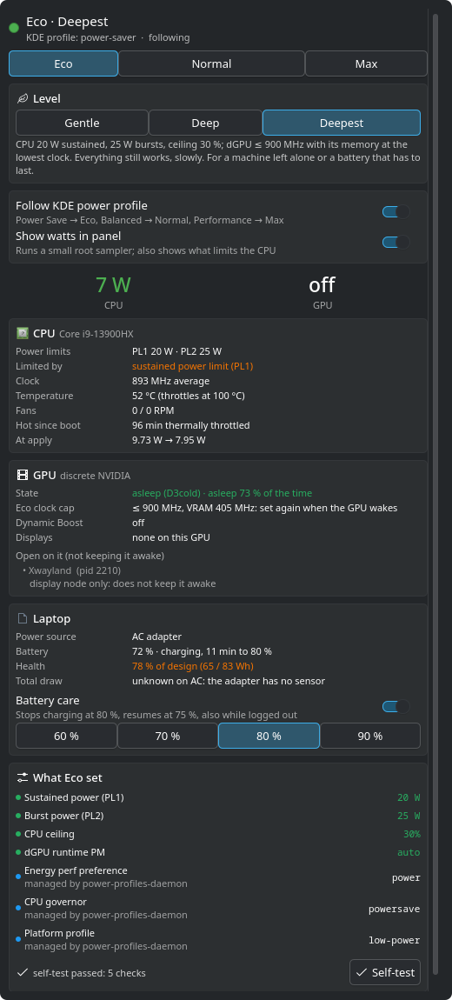
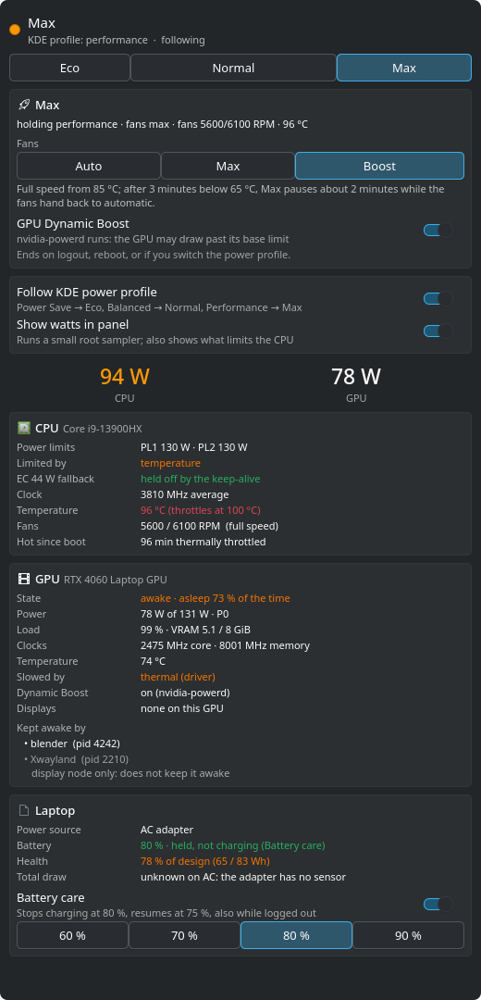
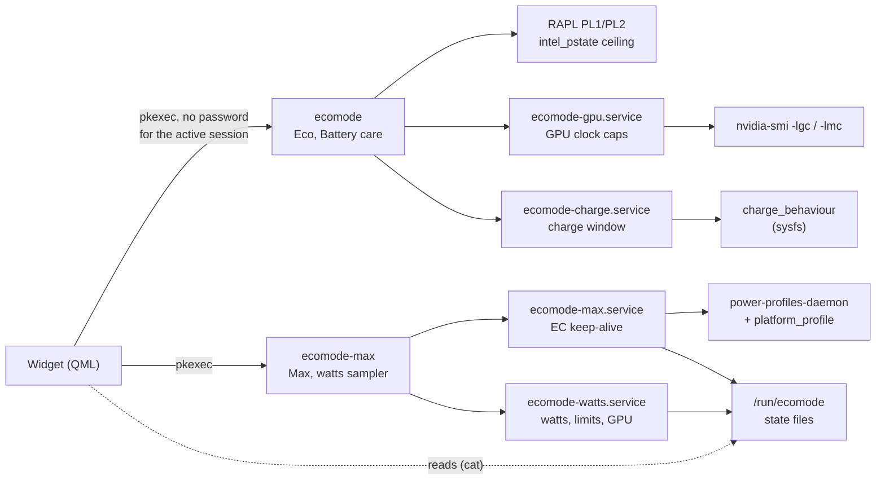
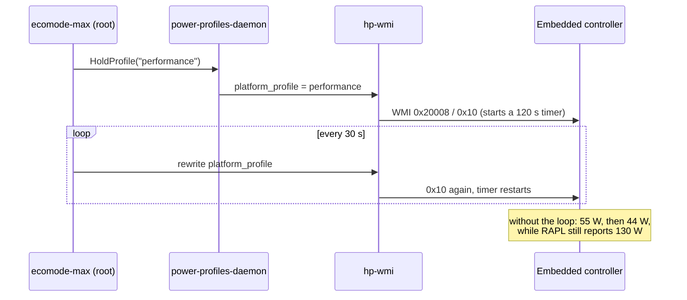
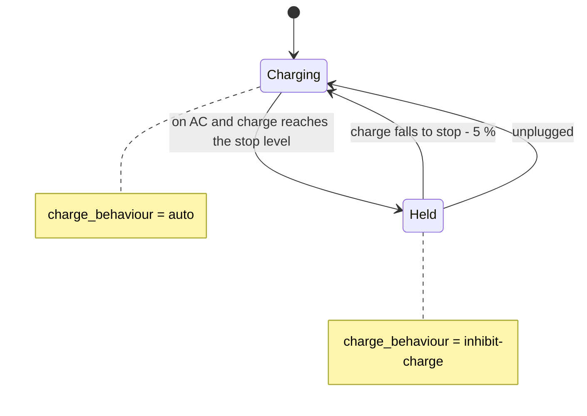

# Power Modes for KDE Plasma

A Plasma 6 panel widget with three power modes (Eco, Normal and Max), live CPU
and GPU watts, a battery charge limit, and a popup that shows what is holding
the CPU back and what keeps the discrete GPU awake.

It was written for, and measured on, an HP OMEN 16 laptop. Most of it works on
any Intel laptop with Plasma 6. Parts it cannot confirm on another machine
switch themselves off, and the popup says why.

<p align="center">
  <br>
  
  
</p>

## What it does

| Mode | What changes |
|---|---|
| Eco | Lowers the CPU's power limits (RAPL PL1/PL2) and frequency ceiling, and at the deeper levels caps the NVIDIA GPU's clocks. Three levels: Gentle, Deep, Deepest. |
| Normal | Nothing. Everything Eco changed is written back to the exact values it found. |
| Max | HP OMEN 16-wf0 only. Keeps the laptop's embedded controller in its performance state so the CPU does not fall back to 44 W after two minutes. Optional fan modes and NVIDIA Dynamic Boost. |

Alongside the modes:

* Battery care stops charging at 60, 70, 80 or 90 % and resumes 5 % lower.
* The popup can follow the KDE Power Profile slider: Power Save turns on Eco,
  Balanced goes to Normal, Performance starts Max.
* The panel can show CPU watts, plus GPU watts while something uses the GPU
  (`21·19W`).
* The popup lists CPU limits and what limits the CPU right now (power limit,
  temperature, PROCHOT), the GPU's state, load, clocks and draw, the processes
  that keep it awake, battery health and time left.

## Measured results

Hardware: HP OMEN 16-wf0 (board 8BAB, Core i9-13900HX, RTX 4060 Laptop,
BIOS F.29), Manjaro with Linux 6.18, Plasma 6.7, NVIDIA driver 610.

| What | Before | After |
|---|---|---|
| CPU under full load, performance profile | 95 to 114 W for 2 minutes, then 55 W, then 44 W for good | Max: 92 to 95 W sustained over a 10 minute run (thermally limited at 96 to 97 °C) |
| GPU during a Blender render, 100 % busy | 66 W at 2475 MHz | Deepest: 19 W with the core at 900 MHz, 6 W with memory at 405 MHz as well |
| GPU power limit, performance profile | 80 W | Max with Dynamic Boost: 130.6 W |
| Whole laptop on battery, light desktop use | 42 W, GPU never asleep, fans at 2500 to 2800 rpm | 24 W, GPU powered down, CPU package 7 W, fans stopped |
| Charging at 40 % on AC with Battery care at the stop level | Charging | "Not charging" within 5 s, and charging again within 5 s once released |

The battery row needs explaining. The widget did not save those 18 W by
itself: it showed what kept the GPU awake. On this machine that was a render
job, a desktop application whose toolkit loaded NVIDIA's EGL library, and KDE's own GPU
temperature sensor, which runs `nvidia-smi dmon` for as long as any widget
shows a GPU value. Once nothing held the GPU, it powered down, and the CPU
could reach deeper idle states too.

## How it works



The widget never runs anything as root on its own. It calls two small Python
helpers through `pkexec`; polkit lets the active local session run them
without a password, and every argument is an enum or a bounded number. Long
running parts are systemd units that only exist while they are needed:

* `ecomode-max.service` and `ecomode-watts.service` belong to your session
  and stop at logout, also with lingering on.
* `ecomode-gpu.service` lives while Deep or Deepest is on.
* `ecomode-charge.service` is the only one that survives a reboot, because a
  charge limit matters most while the laptop charges overnight with nobody
  logged in.

Collapsed in the panel, the widget starts a process only when there is
something to watch: a `cat` of one small file every few seconds while Max runs
or watts are shown, and one status read after the power profile changes.

### Eco levels

| Level | PL1 | PL2 | CPU ceiling | NVIDIA GPU |
|---|---|---|---|---|
| Gentle | 35 W | unchanged | unchanged | runtime power management on |
| Deep | 25 W | 35 W | 40 % (configurable) | core clock at most 1500 MHz |
| Deepest | 20 W | 25 W | at most 30 % | core at most 900 MHz, memory at 405 MHz |

Before writing anything, Eco records every value it is about to change in
`/run/ecomode/state.json`. Normal writes those values back and checks each
one. HP's firmware rewrites the CPU power limits whenever the power profile
changes (Fn+P, the KDE slider), so the widget puts Eco back after every
profile change and records the firmware's new value as the one to restore.
A value that someone else changed after Eco wrote it is left alone.

The GPU caps use clock locks because this laptop's vBIOS refuses
`nvidia-smi -pl` (power limits). A sleeping GPU is never woken to lock it. A
small root unit reads two sysfs files every 5 s and applies the lock once the
card is awake, and again after every time it slept, since the driver may drop
the lock when the card powers down.

### Max on the HP OMEN 16-wf0



The controller keeps a selected thermal profile for only 120 s after the last
`0x10` query, then limits the CPU through PECI. Linux cannot see that: RAPL
keeps reporting 130 W. Max holds the performance profile and rewrites it
every 30 s. It pauses on battery, ends when you pick another profile by hand,
and ends at logout.

Fans inside Max can stay automatic, run at full speed, or go to full speed
from 85 °C until three minutes below 65 °C. Full speed only returns to
automatic about 2 minutes after the last profile write: on this board the
`hp-wmi` request for "automatic" stops the fans instead, so the widget never
sends it and waits for the controller's own timeout.

### Battery care



Battery care uses the kernel's standard `charge_behaviour` property, so it
works with any laptop driver that offers `inhibit-charge` (ThinkPads and some
ASUS models among them). The setting lives in `/var/lib/ecomode/charge.json`.
If the service stops at or above the stop level, charging stays held across
the shutdown. Below it, charging is always set back to normal, so a battery
can never be left unable to charge.

The stock kernel does not offer `charge_behaviour` on the HP OMEN 16-wf0,
although the firmware supports it. [`kernel/hp-wmi-charge`](kernel/hp-wmi-charge)
adds it to the kernel's own `hp-wmi` driver through DKMS. See its README for
what it changes and the checks it runs before it replaces anything.

## Requirements

| | Needed for |
|---|---|
| KDE Plasma 6 | the widget (tested on 6.7; following the KDE slider needs Plasma's D-Bus QML module, present in recent 6.x) |
| Python 3.9 or newer, polkit, systemd | the helpers |
| An Intel CPU with RAPL and `intel_pstate` | Eco's CPU limits and the "Limited by" line |
| power-profiles-daemon | Max and following the slider (it cannot run next to TLP or auto-cpufreq) |
| PyGObject | Max |
| NVIDIA's driver with `nvidia-smi` | GPU clock caps, GPU readings, Dynamic Boost |
| A battery driver with `charge_behaviour` | Battery care |
| HP OMEN 16-wf0 (board 8BAB) | Max, and the charge control module |

Tested on Manjaro. The installer also knows the package names for Arch,
EndeavourOS, Fedora, openSUSE and Debian or Ubuntu (Plasma 6 releases such as
Kubuntu 24.10 or later, Debian 13, KDE neon), but those have not been tried.
Reports are welcome.

## Install

```sh
git clone https://github.com/SoulOriginal/plasma-power-modes.git
cd plasma-power-modes
./install.sh
```

The installer checks what the machine has, tells you how to install anything
missing, copies the widget, installs the helpers, polkit actions and the
charge service (it asks for sudo), and prints which features this machine
supports. Then add the widget: right click the panel, Add Widgets, "Power
Modes".

On an HP OMEN 16-wf0, for Battery care:

```sh
kernel/hp-wmi-charge/install.sh
```

To remove everything and put every setting back:

```sh
./install.sh --uninstall
kernel/hp-wmi-charge/uninstall.sh     # if installed
```

`./install.sh --dev` links the widget to the checkout instead of copying it,
so edits show up after `systemctl --user restart plasma-plasmashell.service`.

## Command line

```sh
ecomode status                       # state, limits, GPU, battery
ecomode status --deep                # plus GPU readings and who holds the GPU
pkexec ecomode on --level deepest    # gentle, deep or deepest
pkexec ecomode off
pkexec ecomode charge on --stop 80   # 50..95
pkexec ecomode charge off
pkexec ecomode-max on --fans boost --gpu-boost
pkexec ecomode-max off
```

Add `--json` for machine-readable output.

## On other machines

| Feature | Elsewhere |
|---|---|
| Max | Button disabled with the reason. It needs board 8BAB and `hp-wmi` with a performance profile. |
| Eco CPU limits | Knobs the machine lacks are skipped. |
| GPU clock caps | Only on an NVIDIA card (found by PCI vendor and class) on NVIDIA's driver. With nouveau or no NVIDIA card, Eco changes the CPU only. |
| "Limited by" | Intel only; the register means something else on AMD. |
| Battery care | Greyed out where the battery driver offers no `charge_behaviour`. |

## If the GPU never sleeps

Open the popup and look at the GPU card. "Kept awake by" lists every process
with an NVIDIA device open. Two that are easy to miss:

* KDE's GPU sensors. Any widget that shows a GPU value makes `ksystemstats`
  run `nvidia-smi dmon` permanently. Remove that sensor, or use a widget that
  reads it only while the GPU is busy anyway.
* Applications whose toolkit loads NVIDIA's EGL library even though they draw
  on the integrated GPU. For a Flatpak app this keeps it on Mesa:
  `flatpak override --user --env=__EGL_VENDOR_LIBRARY_FILENAMES=/usr/lib/x86_64-linux-gnu/GL/default/share/glvnd/egl_vendor.d/50_mesa.json <app-id>`

## Tests

```sh
python3 tests/test_ecomode.py    # Eco, GPU caps, Battery care, portability
python3 tests/test_max.py        # Max keep-alive, fans, watts sampler
node tests/test_modes.mjs        # the widget's logic
```

They run against a fake sysfs and a fake command runner, without root, and
never touch the real machine. They include machines without an NVIDIA GPU,
with nouveau, without a battery, with a battery that offers no charge
control, and with a CPU that is not Intel.

## Contributing

Issues and pull requests are welcome, especially reports from other laptops:
what `ecomode status --deep` shows, what works and what does not. If you add
support for another HP board, please include how you checked the firmware
(the ACPI methods involved), as `kernel/hp-wmi-charge` does for 8BAB.

## License

GPL-2.0-or-later. See [LICENSE](LICENSE). The charge control module is a
patch to the Linux kernel's `hp-wmi` driver and carries the same license.
